<!-- Generated by generate.py - edit the CONFIG there and re-run instead of editing by hand -->
<p align="center">
  
</p>

<p align="center">
  <a href="https://github.com/Malith-Dulsara"></a>
</p>

<p align="center">
  
  <a href="https://github.com/Malith-Dulsara?tab=followers"></a>
  
</p>

<p align="center"></p>

```yaml
player:         Malith Dulsara
class:          Embedded Systems // AI // LLM // GenAudio
main_quest:     UAV development and avionics
side_quests:    [Unreal Engine game dev, open-source support]
off_screen:     Table tennis player
favourite_game: Red Dead Redemption
multiplayer:    [Marvel Rivals, Battlefield 6, Call of Duty]
```

<p align="center"></p>

<p align="center">
  
</p>

<p align="center"></p>

<p align="center">
  
</p>

<p align="center"></p>

<p align="center">
  
  
</p>

<p align="center">
  
</p>

<p align="center">
  
</p>

<p align="center">
  <picture>
    <source media="(prefers-color-scheme: dark)" srcset="https://raw.githubusercontent.com/Malith-Dulsara/Malith-Dulsara/output/snake-dark.svg"/>
    <source media="(prefers-color-scheme: light)" srcset="https://raw.githubusercontent.com/Malith-Dulsara/Malith-Dulsara/output/snake.svg"/>
    
  </picture>
</p>

<p align="center"></p>

<p align="center">
  
</p>

<p align="center">
  
</p>

<p align="center"></p>

<div align="center">

| QUEST | STATUS | REWARD |
|:--|:--:|:--:|
| 🟡 Build a UAV flight & avionics stack | `IN PROGRESS` | **+1000 XP** |
| 🟡 Run LLM / GenAudio models on embedded hardware | `IN PROGRESS` | **+750 XP** |
| 🟡 Ship a game made in Unreal Engine | `IN PROGRESS` | **+500 XP** |
| 🟡 Support open-source projects | `IN PROGRESS` | **+300 XP** |
| 🔒 Win the next table tennis match | `LOCKED` | **+250 XP** |

</div>

<p align="center"></p>

<p align="center"><b>FIND ME IN THE LOBBY OF</b></p>

<p align="center">
  
  
  
  
</p>

<p align="center">
  <a href="https://github.com/Malith-Dulsara"></a>
</p>

<p align="center">
  
</p>
